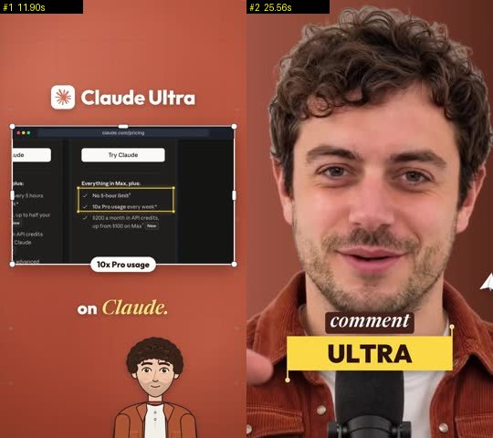
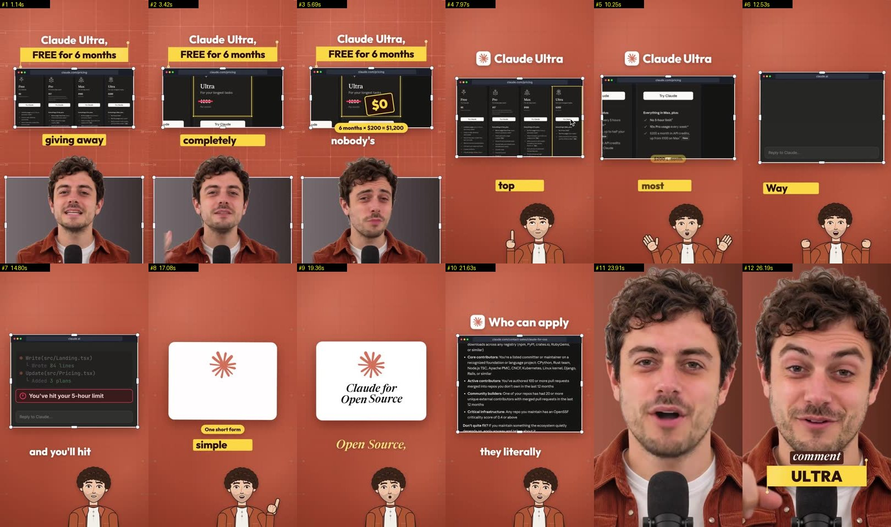

# claude-ultra-workflow

- **المصدر:** https://www.instagram.com/reel/DgGTJuuIC0x/ (الملف رفعه المستخدم، والرابط نفسه محجوب في البيئة)
- **تاريخ الإضافة:** 2026-11-24
- **ما الذي أعجب المستخدم فيه:** طلب نسخة سعودية بنفس السكربت والأنيميشن والمؤثرات. ما ذكر تفصيلاً معيناً عجبه، لازم أسأله.
- **التفريغ النصي:** `transcript_words.json` (whisper small، محلي)

> النص: "Anthropic is giving away six months of Claude Ultra completely free and somehow nobody's talking about it.
> That's their top plan. $200 a month with the most usage you can get on Claude. Way more messages, way more coding,
> and you'll hit limits way less. And there's a simple way to get it. It's called Claude for open source.
> And if you're not sure you qualify, they literally say apply anyway. Comment Ultra and I'll send it over to you. Follow for more."

## مقاس (من tools/analyze.py + تحليل يدوي)
- المدة: **27.3ث** · 720×1280 (9:16) · 30 fps · الصوت **-14.1 LUFS** (LRA 2.4: صوت مضغوط وثابت)
- الأداة كشفت **قطعتين فقط** (عند 23.8ث). هذا **غير دقيق** لهذا النوع: الخلفية ثابتة وكل التغيير في عناصر الجرافيك.
  الإيقاع الفعلي من لوحة 2fps: **عنصر جرافيك جديد كل 1.5 إلى 2.5ث تقريباً** (بطاقة، أو شارة، أو ختم، أو تمييز).
- معدل الكلام: حوالي **3.3 كلمة/ثانية** (90 كلمة في 27ث)، يعني سريع.

## ملاحظ (من لوحات الصور)

### الهيكل (Hook ← قيمة ← دليل ← طريقة ← إزالة اعتراض ← CTA)
| الوقت | الكلام | المرئي |
|---|---|---|
| 0–7.5ث | Hook: «Anthropic is giving away… nobody's talking about it» | وجه المقدم في صندوق بمقابض تحديد (النصف السفلي) + بطاقة متصفح لصفحة الأسعار، زوم على Ultra، شطب $200 وختم **$0**، وشارة «6 months × $200 = $1,200» |
| 7.5–12.5ث | «That's their top plan, $200 a month…» | **ينقلب المقدم إلى كرتون** يشبهه ويأشّر، وبطاقة الأسعار عليها مؤشر يضغط على Ultra، وقائمة المميزات مع إطار أصفر حول «10x» |
| 12.5–17ث | «Way more messages, coding… limits way less» | نافذة دردشة فيها فقاعات تطلع واحدة ورا الثانية، ثم أسطر كود، ثم خطأ أحمر «You've hit your 5-hour limit» ينشطب، وشارة «No 5-hour limit» |
| 17–21.5ث | «simple way… It's called Claude for Open Source» | بطاقة بيضاء فيها الشعار والاسم يُكتب بخط serif مائل، وشارات «One short form» و«It's called» (زرقاء) |
| 21.5–23.8ث | «not sure you qualify? they literally say apply anyway» | لقطة لصفحة شروط الأهلية، وإطار أصفر حول سطر «apply anyway» |
| 23.8–27.3ث | «Comment ULTRA…» | **أول قطع حقيقي**: وجه المقدم بملء الشاشة، و«comment» صغيرة على صندوق داكن، و**ULTRA** ضخمة على صندوق أصفر بمقابض تحديد |

### الكابشن
- المكان: منتصف الشاشة تقريباً (~50 إلى 65% من الارتفاع)، بين البطاقة والمقدم
- الخط: sans سميك أبيض. **كلمات البراند** (Claude, Open Source) بخط serif مائل لونه كريمي/أصفر
- التمييز: صندوق أصفر (#FFD23F تقريباً) والنص داكن على الكلمات المفتاحية (giving away, completely, top, most, Way more, way less, simple way, not sure, apply)
- الظهور: كلمة كلمة مع الكلام، وأحياناً الكلمات الجاية تبان باهتة (مثل «Way more ~~messages~~»)
- 1 إلى 3 كلمات على الشاشة في نفس الوقت

### المونتاج والشكل
- الخلفية: برتقالي طوبي (#D07150 في الوسط إلى #953F23 في الأطراف) مع **شبكة برنامج تصميم**: خطوط، وعلامات +، وأرقام مسطرة على الجانبين (5، 10، 15…)
- كل عنصر عليه **مقابض تحديد** مثل Figma (دوائر في الزوايا وكبسولات في المنتصف) و«دبابيس» صفراء توصل العنوان بالبطاقة
- الحركة: pop مع تجاوز بسيط (overshoot)، وزوم داخل لقطات الشاشة، وmotion blur عند الخروج، وتغيير المحتوى داخل نفس البطاقة
- المقدم: كاميرا ثابتة وإضاءة ناعمة ومايك ظاهر. **التحويل لكرتون** عند 7.5ث يكسر الرتابة

### الصوت (من الطيف الترددي، استنتاج)
- **ما فيه موسيقى خلفية واضحة**: الفراغات بين الكلمات شبه صامتة
- ومضات عريضة تشبه whoosh/impact عند ~4.4ث (ختم $0) و~7.3ث (التحول للكرتون) و~16.5ث، وضربات قصيرة (click/pop) متفرقة
- ~23.7ث: ضربة منخفضة + **نغمة جرس (ding)** واضحة عند الانتقال لـ CTA

## ليش انتشر؟ (تحليل: استنتاج وليس بيانات)
ما عندي أرقام المشاهدات ولا بيانات الوصول، فهذه **أسباب مرجّحة** من بنية الفيديو نفسه:
1. **Hook فيه قيمة مالية ملموسة + ندرة**: «$200 بالشهر ببلاش» + «ولا أحد يتكلم عنه»، يعني FOMO من أول 3 ثواني، والختم البصري $0 يثبّت الفكرة لمن يتفرج بدون صوت.
2. **حساب جاهز على الشاشة**: «6 × $200 = $1,200» يحوّل العرض لرقم واحد كبير.
3. **كثافة بصرية عالية**: شي جديد كل ~2ث، فما فيه لحظة ملل، وهذا يرفع مدة المشاهدة.
4. **إزالة الاعتراض قبل الـ CTA**: «مو متأكد إنك مؤهل؟ هم يقولون قدّم على أي حال» توسّع الجمهور المستهدف.
5. **CTA بكلمة تعليق (ULTRA)**: يرفع التعليقات بشكل كبير (إشارة تفاعل للخوارزمية) ويوصل الرابط بالخاص (غالباً بأداة أتمتة).
6. **مصداقية بصرية**: لقطات من صفحات حقيقية، والعرض فعلاً موجود (تحققت منه، انظر plan.md في المشروع).
7. **وجه + كرتون**: الوجه يبني ثقة، والكرتون يعطي هوية ويكسر النمط.

## تخمين
- برنامج المونتاج غير معروف (ممكن After Effects أو أداة قوالب). الكرتون غالباً مولّد بالذكاء الاصطناعي من صورة المقدم.
- الخطوط: sans يشبه Gilroy/Circular، وserif يشبه Tiempos/Copernicus. لم أتحقق.

## وصفة إعادة الصنع
- preset الكابشن: `design-canvas-karaoke` (الرندر الكامل بالكود: `projects/claude-ultra-saudi/render.py`)
- النسخة السعودية: `projects/claude-ultra-saudi/plan.md`
